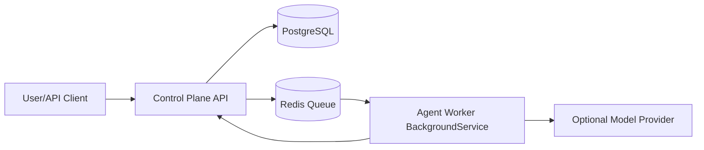

# AI Agent Lab — Current Architecture Assessment (EN)

## Executive Summary

This document summarizes what is currently implemented in the `C:\Enterprise` repository, what is operational today, and what remains missing compared to the target multi-agent platform vision.

**Current state (summary):**
- A working .NET 8 local prototype exists.
- Core runtime path: Control Plane API + Redis queue + Worker + PostgreSQL.
- Basic task lifecycle is operational (`Draft -> Approved -> Executing -> Completed/Failed`).
- As part of Phase 1 Epic 1.1, state-model expansion and transition history infrastructure have been implemented (central transition validation + `task_status_transitions`).
- As part of Phase 1 Epic 1.2, Worker-side transient/permanent retry classification, status update retries, in-memory idempotency, and dead-letter baseline have been implemented.
- As a start of Phase 1 Epic 1.3, Worker reliability unit test infrastructure has been added and the initial test set is passing.
- Local Podman lifecycle scripts and onboarding guidance are strong.
- Multi-agent orchestration, durable task dependency management, product chat UI, GitHub PR automation, and CI/test infrastructure are still early or absent.

**Strategic view:**
The repository is not yet a full productized multi-agent platform; it is a validated local execution core. This is an acceptable and useful intermediate stage.

---

## Technical Appendix

## 1) Repository and solution structure

- Solution: `HumanInControl.sln`
- Projects:
  - `agent-lab/control-plane/ControlPlane.Api.csproj`
  - `agent-lab/agent-worker/AgentWorker.csproj`
  - `tools/run-me/RunMe.csproj`

## 2) Working architecture (as-is)

### Control Plane (`agent-lab/control-plane/Program.cs`)
- Minimal API endpoints:
  - `GET /health`
  - `GET /tasks`
  - `POST /tasks`
  - `GET /tasks/{id}`
  - `POST /tasks/{id}/approve`
  - `POST /tasks/{id}/retry`
  - `POST /tasks/{id}/status`
- Initializes PostgreSQL schema with retry.
- Pushes approved task IDs into Redis queue.

### Worker (`agent-lab/agent-worker/Program.cs`)
- Uses `BackgroundService` to poll queue.
- Loads task payload from API.
- Writes status updates back to API.
- Optional model provider support:
  - `disabled`
  - `podman-ai-lab`
  - `ollama`
  - `openai-compatible`
- Includes transient/permanent-aware retries and endpoint fallback (`chat/completions` -> `completions`).
- Applies transient-aware retries for status update calls.
- Includes an in-memory idempotency guard against duplicate concurrent task processing.
- Writes JSON payloads to a dead-letter queue for terminal failures.

### Local lifecycle
- `docker-compose.yml`: `control-plane`, `agent-worker`, `postgres`, `redis`
- Scripts:
  - `scripts/local.ps1`
  - `scripts/local.sh`
- Commands: `new-build`, `rebuild-all`, `delete-all`, `status`, `bootstrap-dev`
- Explicit confirmation flags are required for data-destructive commands.

## 3) Documentation and decision alignment

Current documentation clearly defines local prototype boundaries and approval/safety gates:
- `README.md`
- `docs-md/continuation.md`
- `docs-md/local-onboarding.md`
- `docs-md/decisions/adr-001-podman-local-prototype.md`

## 4) Gaps against target vision

- Persistent project management layer (multi-project metadata and context)
- Orchestrator agent (intent analysis, task decomposition, dependency handling)
- Multi-agent role/instance management
- Rich task state machine (blocked/cancelled/rejected, etc.)
- GitHub PR automation and policy gates
- Test projects and CI workflow files
- Identity/roles/audit trail infrastructure

## 5) Short conclusion

The repository provides a validated local execution core. The next stage is to evolve this core into product capability with planning, orchestration, governance, and quality gates.

---

## Note for the Next Document

The next separate document will cover:
1. Local development operating model
2. Phase-2 cloud transition approach (AWS, Azure, and similar providers)
3. Hosting and monthly maintenance cost framework
4. Future provider re-evaluation and migration criteria based on price/performance
