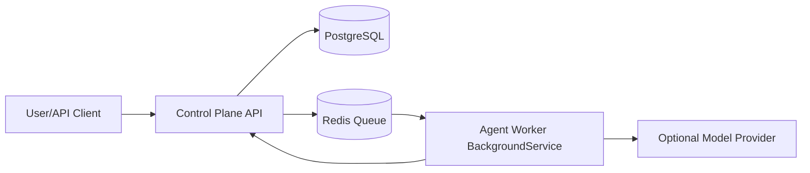

# AI Agent Lab — Mevcut Mimari Değerlendirme (TR)

## Yönetici Özeti

Bu belge, `C:\Enterprise` deposundaki mevcut implementasyonu temel alarak sistemin bugün ne yaptığı, hangi parçaların gerçekten çalıştığı ve hedef vizyona göre hangi alanların eksik kaldığını özetler.

**Mevcut durum (özet):**
- .NET 8 tabanlı çalışan bir local prototip vardır.
- Çekirdek akış: Control Plane API + Redis queue + Worker + PostgreSQL.
- Task yaşam döngüsünün temel hali çalışır (`Draft -> Approved -> Executing -> Completed/Failed`).
- Faz 1 Epik 1.1 kapsamında state model genişletmesi ve transition history altyapısı uygulanmıştır (merkezi geçiş doğrulaması + `task_status_transitions`).
- Faz 1 Epik 1.2 kapsamında Worker tarafında transient/permanent retry sınıflandırması, status update retry, in-memory idempotency ve dead-letter baseline uygulanmıştır.
- Faz 1 Epik 1.3 başlangıcı olarak Worker reliability unit test altyapısı kurulmuş ve ilk test seti başarıyla çalıştırılmıştır.
- Local çalışma için Podman lifecycle scriptleri ve onboarding rehberleri güçlüdür.
- Çok ajanlı orkestrasyon, kalıcı görev bağımlılık yönetimi, chat ürün arayüzü, GitHub PR otomasyonu ve CI/test altyapısı henüz başlangıç seviyesindedir veya yoktur.

**Stratejik yorum:**
Bu depo, “ürünleşmiş çok ajanlı platform”dan çok, “kanıtlanmış local yürütme çekirdeği” aşamasındadır. Bu, doğru bir ara fazdır.

---

## Teknik Ek

## 1) Depo ve çözüm yapısı

- Solution: `AI-Agent-Lab.sln`
- Projeler:
  - `agent-lab/control-plane/ControlPlane.Api.csproj`
  - `agent-lab/agent-worker/AgentWorker.csproj`
  - `tools/run-me/RunMe.csproj`

## 2) Çalışan mimari (as-is)

### Control Plane (`agent-lab/control-plane/Program.cs`)
- Minimal API endpointleri:
  - `GET /health`
  - `GET /tasks`
  - `POST /tasks`
  - `GET /tasks/{id}`
  - `POST /tasks/{id}/approve`
  - `POST /tasks/{id}/retry`
  - `POST /tasks/{id}/status`
- PostgreSQL şemasını başlatır (retry ile).
- Redis’e approve edilen task kimliğini kuyruğa atar.

### Worker (`agent-lab/agent-worker/Program.cs`)
- `BackgroundService` ile kuyruğu dinler.
- Task payload’ını API’den alır.
- Durum güncellemesini API’ye geri yazar.
- Opsiyonel model provider desteği:
  - `disabled`
  - `podman-ai-lab`
  - `ollama`
  - `openai-compatible`
- Model çağrısında transient/permanent sınıflandırmalı retry ve endpoint fallback (`chat/completions` -> `completions`) içerir.
- Status update çağrılarında transient-aware retry uygulanır.
- Aynı task’ın eşzamanlı ikinci kez işlenmesini engelleyen in-memory idempotency guard içerir.
- Terminal başarısızlıklarda dead-letter kuyruğuna JSON payload yazar.

### Local lifecycle
- `docker-compose.yml`: `control-plane`, `agent-worker`, `postgres`, `redis`
- Scriptler:
  - `scripts/local.ps1`
  - `scripts/local.sh`
- Komutlar: `new-build`, `rebuild-all`, `delete-all`, `status`, `bootstrap-dev`
- Veri silme etkisi olan komutlarda açık onay bayrakları zorunludur.

## 3) Dokümantasyon ve karar uyumu

Mevcut dokümantasyon, local prototip sınırlarını ve güvenlik/onay kapılarını net tarif ediyor:
- `README.md`
- `docs-md/continuation.md`
- `docs-md/local-onboarding.md`
- `docs-md/decisions/adr-001-podman-local-prototype.md`

## 4) Eksikler (hedefe göre)

- Kalıcı proje yönetimi katmanı (çok proje, proje metadata, proje bazlı context)
- Orchestrator agent (talep analizi, görev parçalama, bağımlılık çözme)
- Çok ajanlı role/instance yönetimi
- Gelişmiş task state machine (blocked/cancelled/rejected vb.)
- GitHub PR otomasyonu ve policy gate’ler
- Test projeleri ve CI workflow dosyaları
- Kimlik/rol/denetim izi (audit) altyapısı

## 5) Kısa sonuç

Bu repo, hedef platformun temel yürütme çekirdeğini local ortamda kanıtlayan bir başlangıçtır. Sonraki adım, bu çekirdeği “planlama + orkestrasyon + yönetişim + kalite kapıları” ile ürün seviyesine taşımaktır.

---

## Sonraki Belge İçin Not

Bir sonraki dokümanda ayrı ele alınacak başlıklar:
1. Local development operasyon modeli (günlük çalışma standardı)
2. Faz-2 cloud geçiş yaklaşımı (AWS, Azure ve benzeri sağlayıcılar)
3. Barındırma ve aylık bakım maliyet çerçevesi
4. Gerektiğinde sağlayıcı/fiyat-performans yeniden değerlendirme ve geçiş kriterleri
