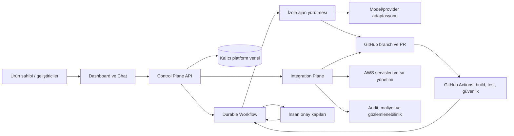

# 04 - Mimari Taslak

Bu belge, kesinleşmiş ürün ilkelerini ve henüz onay bekleyen teknoloji/dağıtım önerilerini ayrı gösterir. Diyagram mantıksal taslaktır; dağıtım topolojisi değildir.

## Mantıksal görünüm

## A. Control Plane

**Sorumluluk:** Proje ve görevlerin kaydı; backlog; ajan tanımlarının yönetimi; workflow başlatma ve durum gösterimi; kullanıcı/rol ve onaylar; audit, maliyet ve bilgi/dokümantasyon görünümü.

**Beklenen bileşenler:** Dashboard, Chat, API, kalıcı veri deposu, workflow entegrasyonu ve bildirim adaptörleri.

**Kesinleşmiş gereksinim:** Dashboard ve Chat aynı Control Plane'i kullanır; workflow durumu konuşma geçmişinden bağımsız ve kalıcıdır.

**Kesinleşmiş prototip yaklaşımı:** Kesintiler kabul edilebilir ve minimum maliyet önceliklidir; yüksek erişilebilirlik/HA zorunlu değildir. Workflow durumu kalıcı olmalı ve servis geri geldiğinde güvenli devam desteklenmelidir.

**Öneri:** API ve web uygulamasını bağımsız ölçeklenebilir dağıtım birimleri olarak değerlendirmek. .NET/ASP.NET Core, PostgreSQL, EF Core ve SignalR yalnızca adaydır. Prototip sonrası erişilebilirlik hedefi ve yönetilen veritabanı maliyetleri doğrulanmadan daha yüksek dayanıklılık yatırımı yapılmamalıdır.

## B. Execution Plane

**Sorumluluk:** Her görev için izole ve geçici çalışma alanı; branch oluşturma; ajan çağrısı; izinli araçlar; build/test; kaynak ve süre limitleri; artefakt toplama.

**Beklenen davranış:** Workflow motoru bir işi başlatır; yürütme ortamı görev kapsamlı izinlerle çalışır; sonuç ve artefaktlar platforma döner; ortam silinir veya yeniden kullanım politikasıyla sınırlandırılır. Kesinti halinde devam kararı kalıcı workflow durumundan alınır, sohbet belleğinden değil.

**Öneri:** AWS ECS/Fargate, konteyner ve S3 değerlendirme adaylarıdır. Görev başına egress, GitHub erişimi, paket indirme ve geçici disk ihtiyacı ölçülmeli; ajanlara üretim sırları verilmemelidir.

## C. Integration Plane

**Sorumluluk:** GitHub, AWS, CI/CD, model sağlayıcıları, sır yönetimi, bildirimler ve gelecekteki dış sistemlerle kontrollü bağlantı.

**Öneri:** GitHub Actions için AWS OIDC, AWS Secrets Manager ve S3 adaydır. Her entegrasyon kapsamlı izin, audit ve hata/yeniden deneme davranışına sahip olmalıdır. OIDC veya başka bir entegrasyon seçimi, yetki tasarımı onaylanmadan uygulanmamalıdır.

## Ajan ve workflow sorumluluk ayrımı

- **Ajan orkestrasyonu:** Ajan rolünü, talimatlarını, modelini, araçlarını, bağlamını ve çok ajanlı etkileşimi koordine eder. LangGraph ve Semantic Kernel bu tür akışlarda değerlendirilebilir.
- **Durable workflow orkestrasyonu:** Uzun süreli adımların kalıcı durumunu, retry/timeout, hata kurtarma, bekleme ve insan onaylarını yönetir. Temporal bu kategori için adaydır; uygulama içi durum makinesi de kapsamı küçük tutan bir alternatiftir.
- **Önemli:** Bir ajan framework'ü tek başına dayanıklı workflow garantisi olarak kabul edilmemelidir. İki ayrı ürün kullanmak da otomatik olarak daha iyi değildir; entegrasyon ve operasyon maliyeti kanıtlanmalıdır.

## Önerilen görev akışı

1. Kullanıcı Chat veya Dashboard üzerinden talep açar; görev taslağı Control Plane'de kaydedilir.
2. Ürün analizi ve mimari plan hazırlanır. Plan, kapsamı, riskleri ve kabul ölçütlerini içerir.
3. Kullanıcı planı onaylar veya değişiklik ister. Onay kaydı kullanıcı ve sürüm bilgisiyle kalıcılaştırılır.
4. Workflow, sınırlandırılmış bir ajan yürütmesini başlatır. Yürütme yalnızca onaylı proje/repo ve izinli araçlara erişir.
5. Ajan değişiklik, test sonucu ve artefakt üretir; QA/Security kontrolleri uygulanır.
6. GitHub PR oluşturulur; Actions doğrulamaları ve insan incelemesi tamamlanır.
7. Birleştirme ve üretim dağıtımı ayrı kapılardır. Üretim için açık insan onayı gerekir.
8. Sonuç, maliyet, audit kaydı ve workflow durumu güncellenir; hata durumunda retry/resume/iptal kuralları uygulanır.

## Kalıcı durum ve sınırlar

İlk workflow durumları brief'teki Draft, Analyzing, Planning, AwaitingApproval, Executing, Validating, PullRequestCreated, AwaitingReview, Completed, Rejected, Failed, Cancelled ve Paused değerlerini kapsayabilir. Geçiş kuralları, idempotency, eşzamanlılık, retry ve manuel müdahale semantiği tasarım aşamasında tanımlanmalıdır.

Veri katmanları; proje/görev kayıtları, sırlar, kaynak kod, kısa ömürlü ajan çalışma alanları, loglar ve artefaktlar olarak ayrılmalıdır. Saklama ve silme politikası henüz açık sorudur.

## Başlıca mimari riskler

- Prototip sonrası erişilebilirlik hedefi ve buna ayrılacak bütçenin henüz belirlenmemiş olması.
- Workflow motoru ve ajan runtime'ının aynı sorumlulukları üstlenerek karmaşıklık yaratması.
- Ajanın repo dışı erişimi veya görevler arası veri sızıntısı.
- Sağlayıcıya gönderilen istem/artefaktlarda kişisel veya gizli veri bulunması.
- AWS ağ çıkışı, log, veri tabanı ve yedek maliyetlerinin erken tahminde eksik kalması.
- Marketplace'in yasal/ürün sınırları netleşmeden hassas kullanıcı verilerinin modellenmesi.